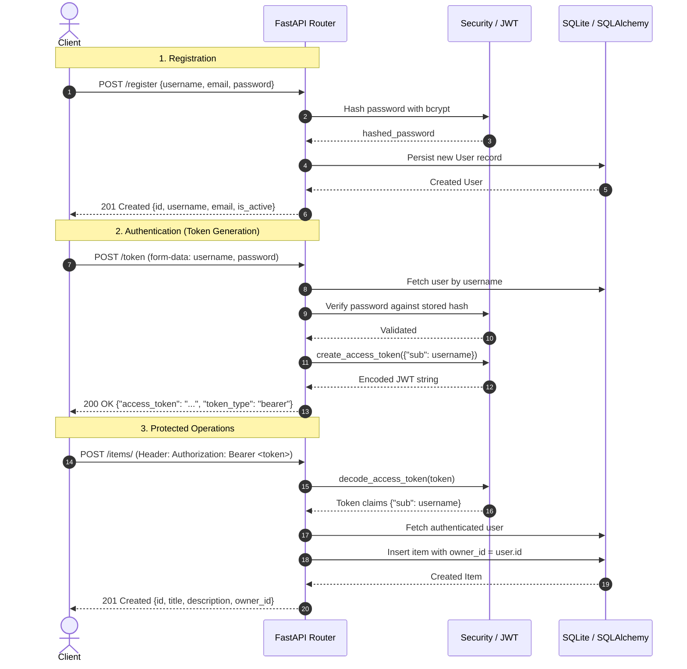

# FastAPI Microservice with JWT Authentication (`auth-service`)

**Task 05: FastAPI / Flask Microservice with JWT Authentication**  
*RabTech Python Software Engineering Internship*  
**Author:** Faizan Ali (`git.faizanali@gmail.com`)

---

## Overview

The **Auth & Item Management Microservice** is a production-ready, asynchronous RESTful API built with **FastAPI**, **SQLAlchemy ORM (SQLite)**, **Pydantic v2**, and **JSON Web Token (JWT)** security with bcrypt password hashing.

### Key Capabilities
- **OAuth2 Password Flow:** Secure login exchanging user credentials for signed JWT bearer tokens.
- **Cryptographic Security:** Passlib & Bcrypt salt-hashed passwords, 256-bit signed tokens with expiration claims.
- **Role & Ownership Modeling:** Relational SQLAlchemy models linking items to authenticated owner users with cascading deletes.
- **Strict Data Validation:** Comprehensive Pydantic v2 schemas enforcing request validation and response filtering (passwords are never leaked).
- **Interactive Documentation:** Automatic OpenAPI documentation generated at `/docs` (Swagger UI) and `/redoc` (ReDoc).
- **Automated Testing:** 100% passing test suite achieving **95% code coverage**.

---

## Directory Structure

```text
.
├── .gitignore
├── pyproject.toml
├── README.md
├── src/
│   └── auth_service/
│       ├── __init__.py
│       ├── database.py
│       ├── models.py
│       ├── schemas.py
│       ├── security.py
│       ├── crud.py
│       └── main.py
└── tests/
    └── test_api.py
```

---

## Architecture & Authentication Flow



---

## API Endpoints Reference

| Method | Endpoint | Access | Request Body | Description |
|---|---|---|---|---|
| `GET` | `/` | Public | None | Service health check and metadata. |
| `POST` | `/register` | Public | `UserCreate` (JSON) | Register a new user with bcrypt-hashed password. |
| `POST` | `/token` | Public | `OAuth2PasswordRequestForm` (Form) | Login to retrieve signed JWT Access Token. |
| `GET` | `/users/me` | Protected (Bearer JWT) | None | Retrieve authenticated user profile and owned items. |
| `POST` | `/items/` | Protected (Bearer JWT) | `ItemCreate` (JSON) | Create a new item linked to the authenticated user. |
| `GET` | `/items/` | Public | Query params: `skip`, `limit` | Paginated listing of all items across the system. |

---

## Installation & Setup

### 1. Create Virtual Environment
```bash
# Windows
python -m venv .venv
.venv\Scripts\activate

# Linux / macOS
python3 -m venv .venv
source .venv/bin/activate
```

### 2. Install Package in Editable Mode
```bash
# Windows
.venv\Scripts\python -m pip install --upgrade pip
.venv\Scripts\pip install -e ".[dev]"

# Linux / macOS
.venv/bin/python -m pip install --upgrade pip
.venv/bin/pip install -e ".[dev]"
```

---

## Running the Application

Start the Uvicorn development server:
```bash
# Windows
.venv\Scripts\uvicorn auth_service.main:app --reload --host 127.0.0.1 --port 8000

# Linux / macOS
.venv/bin/uvicorn auth_service.main:app --reload --host 127.0.0.1 --port 8000
```

Once running, navigate to:
- **Interactive Swagger UI:** [http://127.0.0.1:8000/docs](http://127.0.0.1:8000/docs)
- **Alternative ReDoc UI:** [http://127.0.0.1:8000/redoc](http://127.0.0.1:8000/redoc)

---

## Step-by-Step Usage Examples (curl)

### 1. Register a New User
```bash
curl -X POST "http://127.0.0.1:8000/register" \
  -H "Content-Type: application/json" \
  -d '{
    "username": "faizanali",
    "email": "git.faizanali@gmail.com",
    "password": "StrongPassword123!"
  }'
```
**Response (201 Created):**
```json
{
  "username": "faizanali",
  "email": "git.faizanali@gmail.com",
  "id": 1,
  "is_active": true,
  "items": []
}
```

### 2. Obtain JWT Access Token
```bash
curl -X POST "http://127.0.0.1:8000/token" \
  -H "Content-Type: application/x-www-form-urlencoded" \
  -d "username=faizanali&password=StrongPassword123!"
```
**Response (200 OK):**
```json
{
  "access_token": "eyJhbGciOiJIUzI1NiIsInR5cCI6IkpXVCJ9...",
  "token_type": "bearer"
}
```

### 3. Access Protected Route (`/users/me`)
```bash
curl -X GET "http://127.0.0.1:8000/users/me" \
  -H "Authorization: Bearer <YOUR_ACCESS_TOKEN>"
```

### 4. Create an Authenticated Item
```bash
curl -X POST "http://127.0.0.1:8000/items/" \
  -H "Authorization: Bearer <YOUR_ACCESS_TOKEN>" \
  -H "Content-Type: application/json" \
  -d '{
    "title": "Banking Ledger Engine",
    "description": "High performance algorithmic financial ledger"
  }'
```

### 5. Fetch Public Items List
```bash
curl -X GET "http://127.0.0.1:8000/items/?skip=0&limit=10"
```

---

## Test Execution & Coverage Report

The test suite utilizes an isolated in-memory SQLite database (`sqlite:///:memory:`) and FastAPI's `TestClient` to test all authentication edge cases:

```bash
# Windows
.venv\Scripts\python -m pytest -v

# Linux / macOS
.venv/bin/python -m pytest -v
```

### Test Results
```text
============================= test session starts =============================
platform win32 -- Python 3.14.10, pytest-9.2.0, pluggy-1.7.0
rootdir: C:\Users\Aly\Desktop\RabTech\task5
configfile: pyproject.toml
testpaths: tests
plugins: anyio-4.16.0, cov-7.1.0
collected 6 items

tests/test_api.py::test_root_endpoint PASSED                             [ 16%]
tests/test_api.py::test_user_registration_success PASSED                 [ 33%]
tests/test_api.py::test_user_registration_duplicate_username_and_email PASSED [ 50%]
tests/test_api.py::test_token_generation_and_login PASSED                [ 66%]
tests/test_api.py::test_protected_users_me_route PASSED                  [ 83%]
tests/test_api.py::test_item_creation_and_listing PASSED                 [100%]

=============================== tests coverage ================================
Name                           Stmts   Miss  Cover   Missing
------------------------------------------------------------
src\auth_service\__init__.py       1      0   100%
src\auth_service\crud.py          32      1    97%   12
src\auth_service\database.py      12      4    67%   21-25
src\auth_service\main.py          49      2    96%   37, 43
src\auth_service\models.py        18      0   100%
src\auth_service\schemas.py       17      0   100%
src\auth_service\security.py      24      1    96%   33
------------------------------------------------------------
TOTAL                            153      8    95%
============================== 6 passed in 7.71s ==============================
```

- **All 6 tests passed (100%).**
- **Test coverage:** **95%**.
